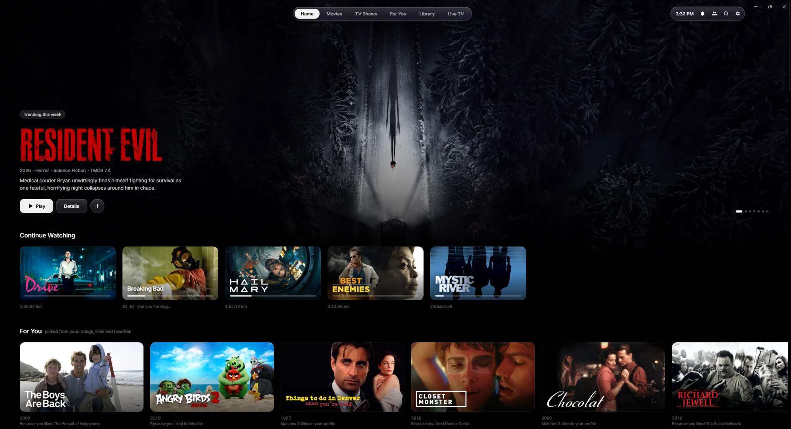
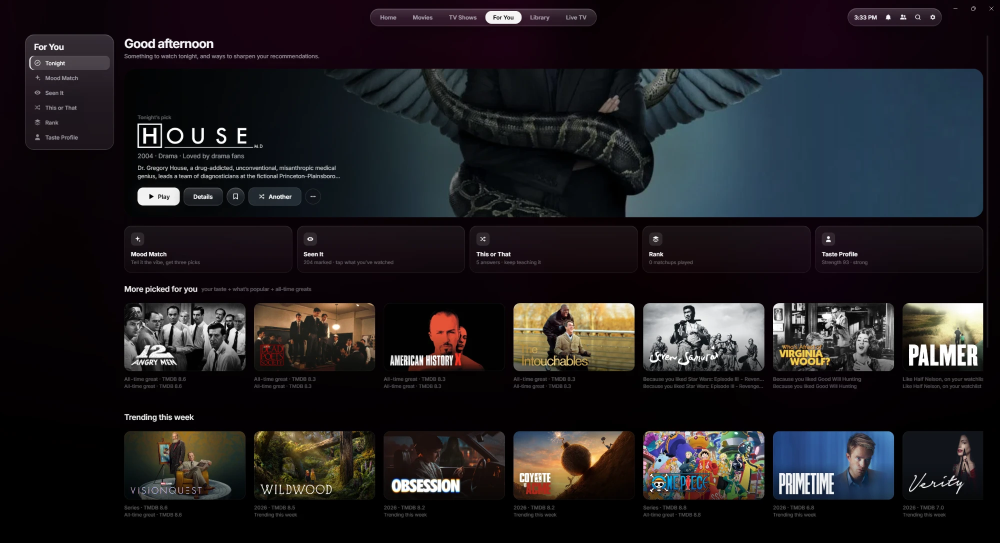
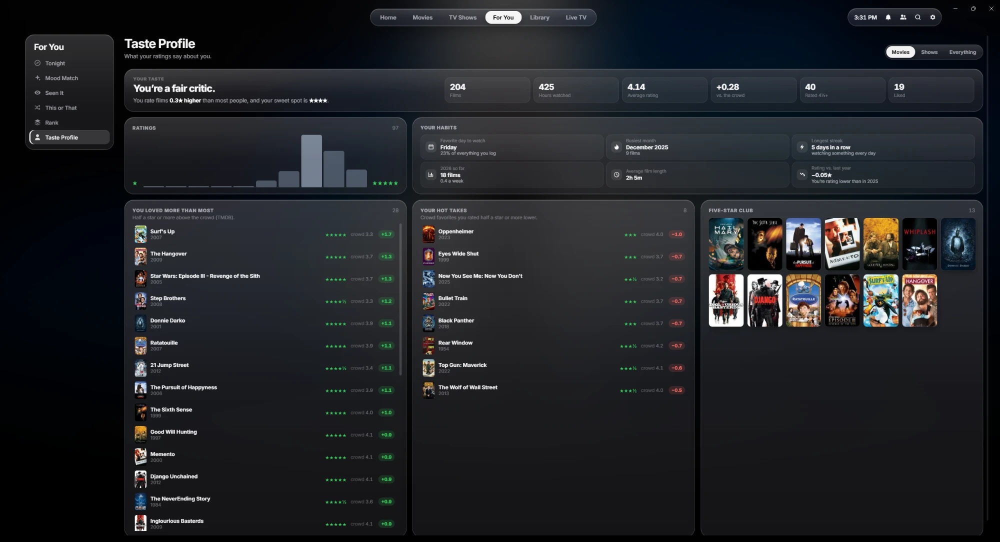
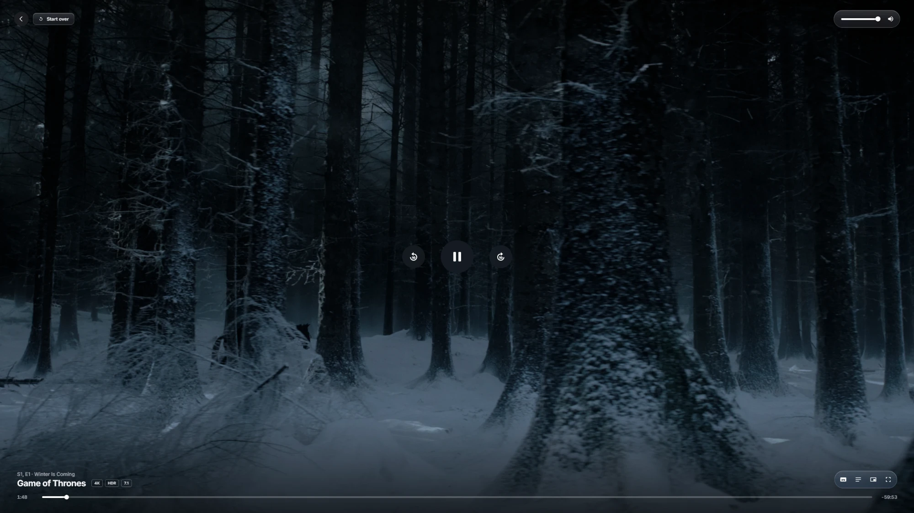
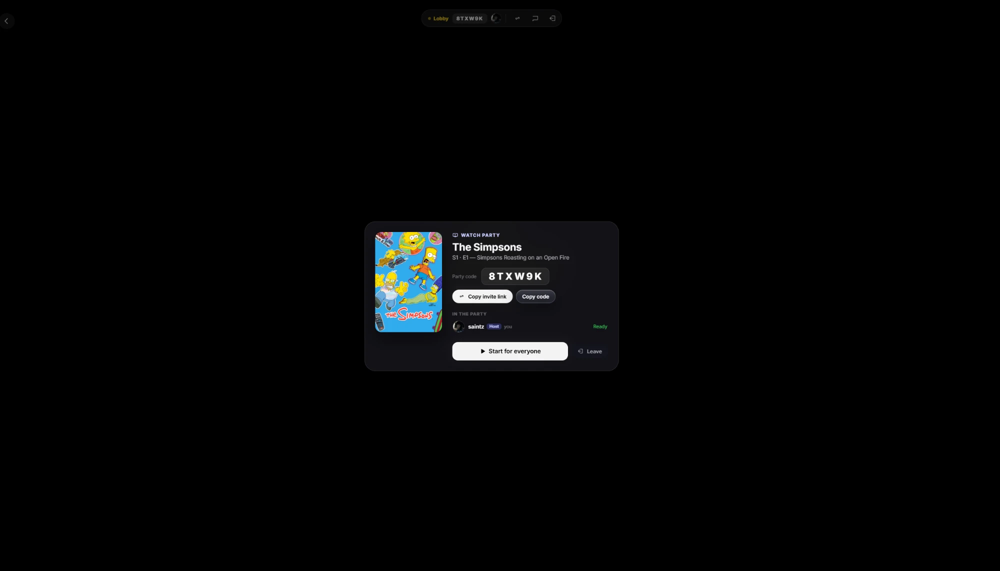
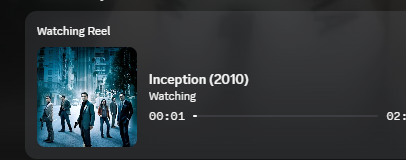
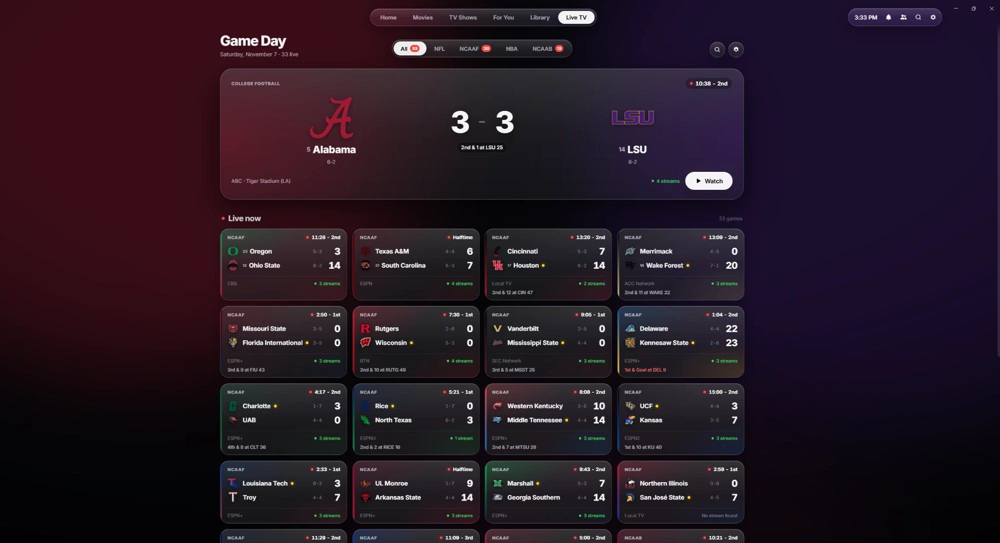

  

<h1 align="center">Reel</h1>

  <b>Track, rate and watch movies and shows — with recommendations that learn your taste, a clean macOS-style app, and your friends. On Windows, Mac, Fire TV, your phone and any browser.</b>

  

  <b>Reel 1.3 is out</b>: Reel on your phone, a better TV app, One Pace and smarter stream picks · <a href="https://github.com/saintzdid12/reel/releases/latest">See what’s new →</a>

  

## Find something to watch
- **For You** picks built from your ratings, likes, favorites and rewatches — they get better the more you use Reel
- **Tonight's pick**, **Mood Match**, **Seen It**, **This or That** and **Rank** your all-time favorites
- Search, genres, studios, trending and top 10s

  

## Keep track, like Letterboxd
- Ratings, likes, a watch diary, reviews, lists and a watchlist
- Import your whole Letterboxd history in one go, and **Re-sync from Letterboxd** any time: export your data there, pick the file, and Reel adds only what's new
- Careful title matching (it checks the title, not just the year), and **Wrong movie?** on any title moves your rating, diary and review to the right one
- **Taste Profile** — your ratings spread, where you differ from the crowd, your five-star club and watching habits

  

## Watch
- Plays from **your own debrid account** — Real-Debrid, TorBox, AllDebrid, Premiumize, Debrid-Link, EasyDebrid or Offcloud
- HD by default, up to 4K HDR with 7.1 audio, subtitles and automatic next episode
- Works on any PC: video a laptop can't show is converted on the fly
- Picks up where you left off, on any of your devices. Sign in on a new one and your debrid key comes with you, so you can start watching right away
- **Smart stream picks**: popular, properly sourced releases first, theatre recordings caught, and a different film with the same name is spotted (by its running time) and skipped
- **Continue Watching** shows what you're partway through and the next episode of every show you're on
- **One Pace**: on One Piece's page, *One Pace version* plays the fan edit without the filler, every arc, subbed or dubbed

  

## With friends
- Sign in with Discord or a Reel username, and your library syncs across every computer — Windows and Mac
- Add friends, see what they're watching and rating, and how well your tastes match
- **Watch parties**: share a code or link and everyone stays in sync, with chat, reactions and host controls. If someone's video is still loading, the party waits for them (you can see who) and starts again together. If the host leaves or drops out, the next person takes over automatically
- Profiles with favorites, films and **TV shows** (including where you are, like *S2 · E5*), reviews and stats
- Notifications for friend requests and parties wait quietly in the bell. Nothing pops up
- A lobby with a countdown, and shows that continue to the next episode together
- Your Discord profile shows what you're watching

  

  

## Live TV (optional)
Turn it on in Settings and connect your own IPTV subscription — **Game Day** shows every live game with scores and picks the right channel for you.

  

## Install

### Windows
1. Download **Reel-Setup-….exe** from the [latest release](https://github.com/saintzdid12/reel/releases/latest) (or the [download page](https://saintzdid12.github.io/reel)).
2. Windows may say *"Windows protected your PC"* the first time — click **More info → Run anyway**.
3. Reel **updates itself** from then on — a button under the top-right icons shows the download, then *Update ready · Restart*. Restarting shows the installer's progress and Reel reopens by itself.

### Mac
1. Download **Reel-…-mac-arm64.dmg** (Apple Silicon — any Mac from late 2020 on) or **Reel-…-mac-x64.dmg** (older Intel Macs) from the [latest release](https://github.com/saintzdid12/reel/releases/latest).
2. Open it and drag **Reel** into **Applications**.
3. The first time you open it, macOS may say it can't check the app. Open **System Settings → Privacy & Security**, scroll down and click **Open Anyway**. You only do this once.
4. When there's a new version, Reel shows a *Download* button — open it and drag the new Reel into Applications again.

### On your phone (or any browser)
Open **https://saintzdid12.github.io/reel/app/** and sign in with Discord or your Reel username (or link it from Reel on your computer: **Settings → Account → Link a device**). Add it to your home screen for a full-screen app: on iPhone, **Share → Add to Home Screen**; on Android, **⋮ → Install app**.
Works best with **Real-Debrid**, which converts any movie to phone-friendly video on its own servers. With TorBox, only versions a browser can play directly are listed.

### Fire TV and Android TV
1. On a Fire TV, install the free **Downloader** app from the Amazon Appstore, open it and enter:
   `https://github.com/saintzdid12/reel/releases/latest/download/Reel-TV.apk`
   (On an Android TV, open the same link with any downloader or file manager.)
2. If the TV asks, allow Downloader to install apps, then choose **Install**.
3. Open Reel and sign in: type the code the TV shows into **Settings → Account → Link a device** on your computer, or use your Reel username and password. Your library and debrid service come with your account.
4. **To update**, open Downloader and enter the same link again, then choose **Install**. Your account, library and place in every show stay as they are.
5. On the TV: **Down** from the timeline reaches Subtitles and Audio, and the next episode starts by itself (press **OK** on *Up next* to start it right away).

### Setup (computer)
**One step:** pick your debrid service from the list and paste its API key (there's a *Find your API key* link for each one), then choose HD or 4K. Movie info is built in, so there's no TMDB key to set up.

**Needs:** Windows 10/11 or macOS 11+ · a debrid account — [Real-Debrid](https://real-debrid.com), [TorBox](https://torbox.app), [AllDebrid](https://alldebrid.com), [Premiumize](https://www.premiumize.me), [Debrid-Link](https://debrid-link.com), EasyDebrid or [Offcloud](https://offcloud.com)

## Privacy
- Your debrid API key is stored encrypted on your PC. If you sign in, it's also saved privately to your Reel account so it follows you to your other computers; only you can read it.
- Reel plays only from your own debrid account. It never downloads, seeds or shares torrents on your computer.
- A Reel account is optional. If you sign in, your library (ratings, diary, lists, watchlist, where you left off), settings, profile and debrid key are synced. Live TV logins stay on your PC, and what you stream is never recorded.
- Friends only see what you choose to share, and any title can be hidden from them.

---

This product uses the TMDB API but is not endorsed or certified by TMDB. Reel doesn't host or provide any content. It plays streams from services you have your own account with.
